<div align="center">


# Pipa — Landing Page

### Pick a kite, race it down the page, then meet the app that shares the house. 🪁

The landing page of **[Pipa: Para Partilhar](https://apps.apple.com/br/app/pipa-para-partilhar/id6799178383)**, an iOS app that splits household chores fairly and gives a name to the invisible work of *noticing, remembering, deciding and following up*.

<br/>

[](https://apps.apple.com/br/app/pipa-para-partilhar/id6799178383)
[](https://react.dev)
[](https://vitejs.dev)
[](https://www.framer.com/motion/)

<br/>

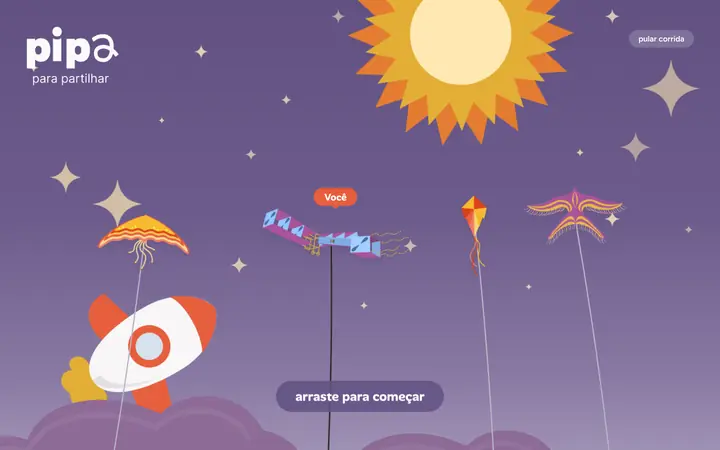

</div>

---

## 📑 Table of Contents

- [About](#-about)
- [The Kite Race](#-the-kite-race)
- [The Landing Page](#-the-landing-page)
- [Interactions Borrowed from the App](#-interactions-borrowed-from-the-app)
- [On Mobile](#-on-mobile)
- [Tech Stack](#-tech-stack)
- [Project Structure](#-project-structure)
- [Getting Started](#-getting-started)
- [Related](#-related)

---

## 📖 About

Pipa's whole identity is built around kites. So instead of opening with a regular hero section, the landing page starts with a **kite race**: the visitor picks a kite, scrolls down to fly it from a starry night sky to a finish line in the hills, and only then lands on the traditional page.

Visitors who just want the information can **skip** the race at any time and go straight to the landing page.

---

## 🏁 The Kite Race

<table>
  <tr>
    <td width="50%">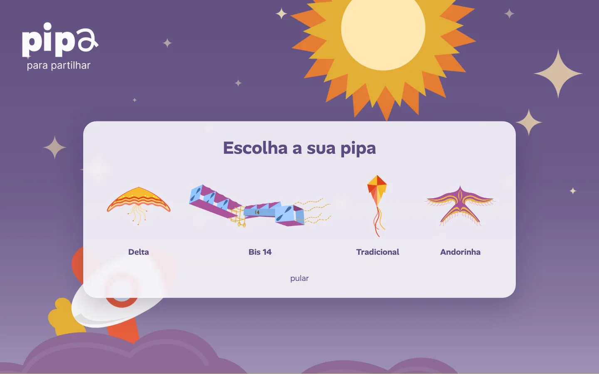</td>
    <td width="50%"></td>
  </tr>
  <tr>
    <td align="center"><b>1. Pick a kite</b><br/>Delta, Bis 14, Tradicional or Andorinha, or skip the race.</td>
    <td align="center"><b>2. Drag to start</b><br/>Your kite is tagged <i>Você</i>; scrolling moves the sky.</td>
  </tr>
  <tr>
    <td width="50%">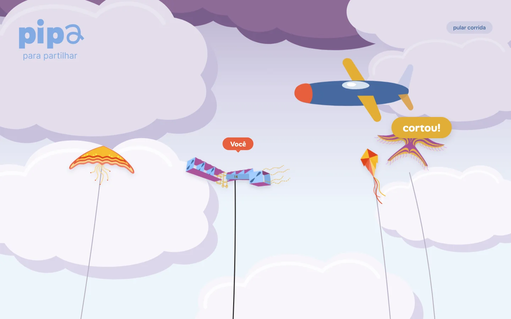</td>
    <td width="50%">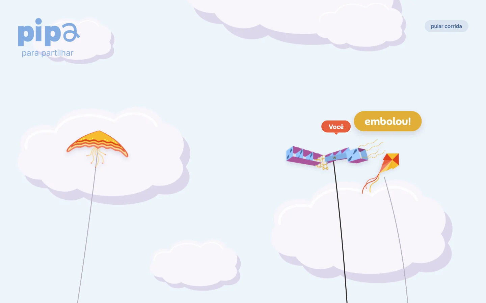</td>
  </tr>
  <tr>
    <td align="center"><b>3. Cuts along the way</b><br/><i>cortou!</i>: the cut kite drifts away with the wind.</td>
    <td align="center"><b>4. Tangles too</b><br/><i>embolou!</i>: the tangled kite spins and falls.</td>
  </tr>
</table>

<div align="center">
  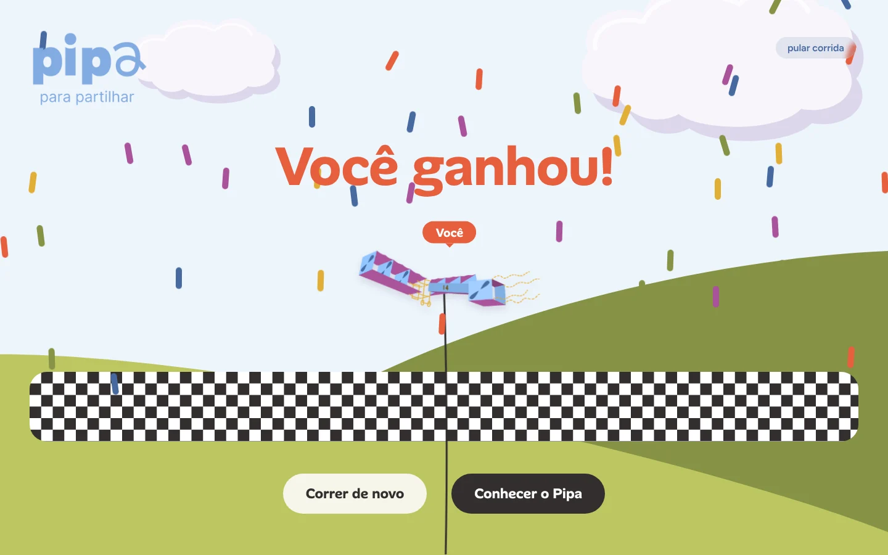
  <br/>
  <b>5. The finish line</b>: <i>Você ganhou!</i> with confetti, or <i>Você perdeu!</i> with the name of the winner. Then you can run again or keep scrolling into the page.
</div>

### How it works

- **The race is a pure function of scroll progress.** `getRaceFrame(plan, progress)` in [`src/race/raceEngine.js`](src/race/raceEngine.js) returns where every kite is, which ones were already cut and which speech bubbles are visible. Scrolling back up rewinds the race.
- **Every race is different.** `createRacePlan` draws a random winner and the order of eliminations. A kite is always cut by one of its lane neighbours, so the lines really cross.
- **Lines are tied to the knot.** Each kite has an `anchor` point in its image; it sits exactly where the line starts, so kites rotate around the knot like real ones.
- **The sky is one tall scene** (sun, stars, rocket, clouds, airplane, hills) that slides behind a sticky viewport, from night to day.

---

## 🏠 The Landing Page

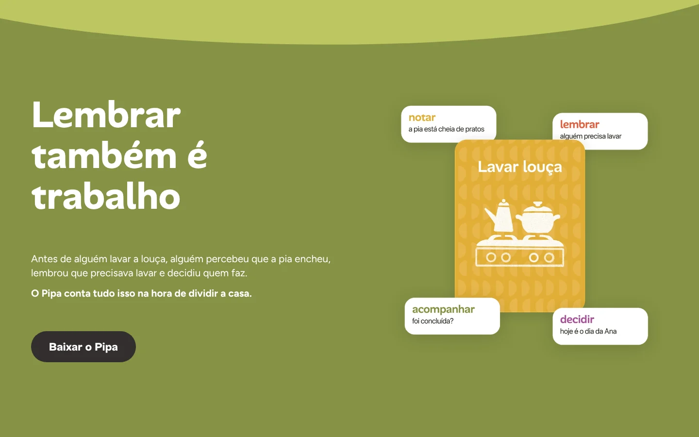

<table>
  <tr>
    <td width="50%">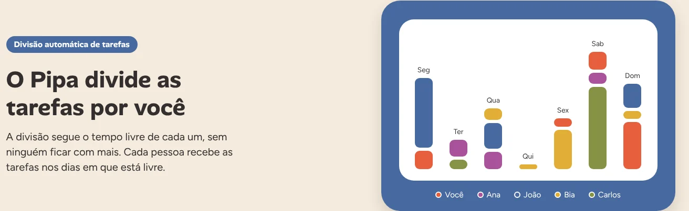</td>
    <td width="50%">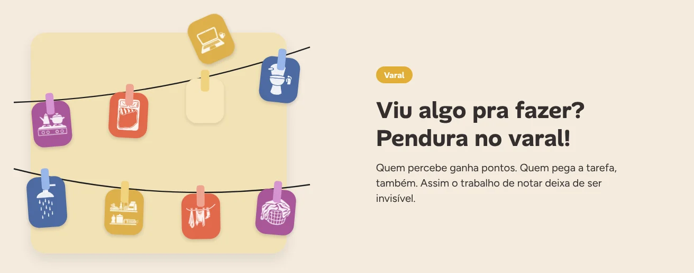</td>
  </tr>
  <tr>
    <td width="50%">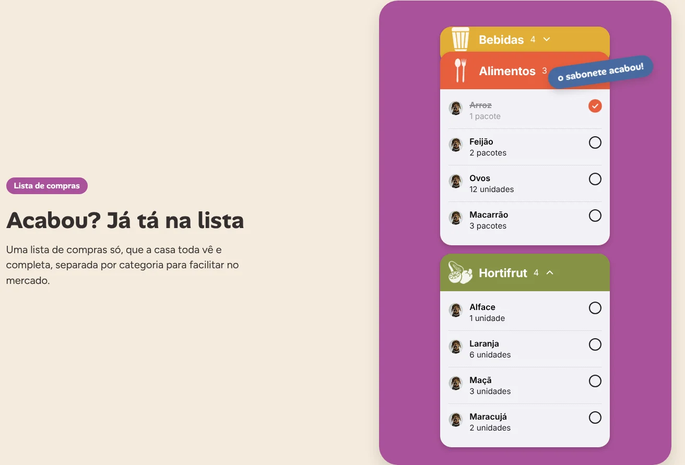</td>
    <td width="50%">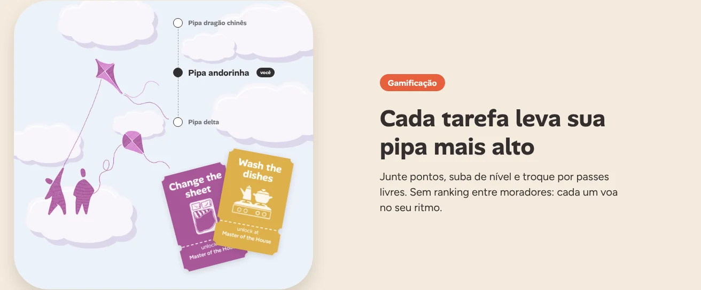</td>
  </tr>
  <tr>
    <td width="50%">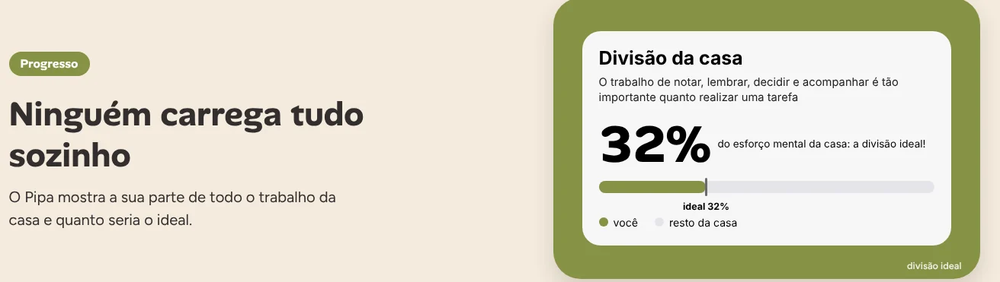</td>
    <td width="50%">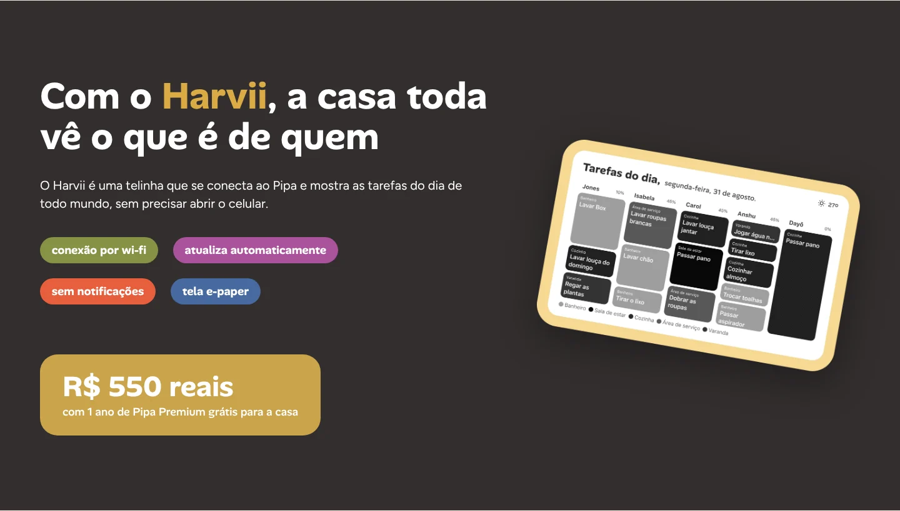</td>
  </tr>
</table>

---

## ✨ Interactions Borrowed from the App

Each feature on the page is a small live component instead of a static picture, and each one follows the behaviour of the matching screen in the iOS app.

| Component | What you can do | Based on |
| --- | --- | --- |
| **Week chart** | Columns grow when they appear; hover a person to highlight their chores | The fortnight division chart |
| **Clothesline** | Tiles swing on their clothespins; click one to take the chore (+10 pts), or hang the floating new task (+5 pts) | `ClotheslineCarousel` (same rope curve and tilts) |
| **Shopping list** | Categories open and close stacked like folders; tick items off | `ShopSectionStack` (same stacking rules and spring) |
| **Gamification** | People flying kites, frame by frame; free passes fan out on hover | `FrameAnimationView` (16 frames, 12 fps, back and forth) |
| **House share** | Hover to fill your share up to the ideal, with the colour changing as it gets there | `BarPercentageComponent` (same colour rules) |

All animations respect **Reduce Motion**.

---

## 📱 On Mobile

<div align="center">
  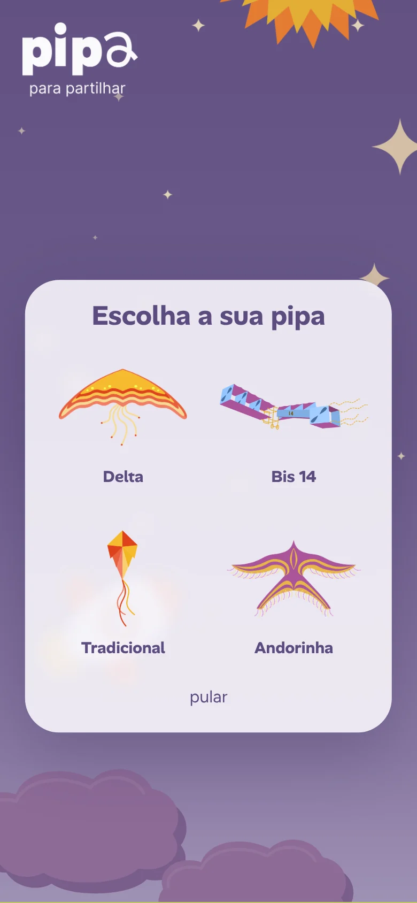
  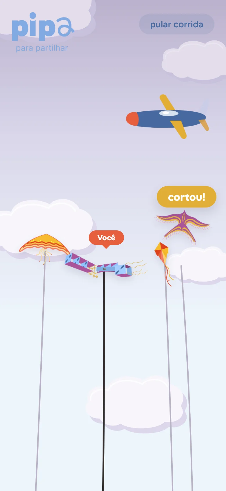
  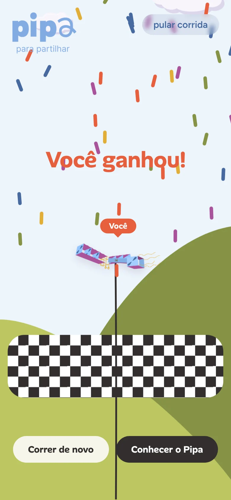
</div>

---

## 🛠 Tech Stack

- **React 18** + **Vite 5**
- **Framer Motion** for the shopping list's layout animations
- Plain CSS with container query units, so illustrated cards scale as one piece
- **Alan Sans** (the app's typeface, SIL Open Font License) and **Figtree**, bundled locally
- No UI library and no backend: it builds to a static site

---

## 🗂 Project Structure

```
src/
├── App.jsx                  # page flow: select → race → landing (or skip)
├── race/raceEngine.js       # race plan + frame-by-frame state from scroll progress
├── hooks/                   # scroll progress, reveal on scroll, frame animation
├── data/kites.js            # the four kites and the anchor point of each one
├── components/
│   ├── sky/                 # sun, stars, clouds, rocket, airplane, hills, the sky "world"
│   ├── race/                # kite picker, kites and lines, result screen, confetti
│   └── landing/             # hero, features, Harvii, footer
│       └── interactive/     # week chart, clothesline, shopping list, gamification, house share
├── assets/                  # kites, icons from the app, fonts, illustrations
└── styles/global.css        # colour tokens, typography, shared buttons
```

---

## 🚀 Getting Started

**Requirements:** Node.js 18 or newer.

```bash
git clone https://github.com/MegaFinal/Pipa_Landing.git
cd Pipa_Landing
npm install
npm run dev       # local server
npm run build     # production build in dist/
npm run preview   # serve the build
```

The build uses relative paths (`base: './'`), so `dist/` can be hosted anywhere, GitHub Pages included.

---

## 🔗 Related

- **The app:** [MegaFinal/Pipa](https://github.com/MegaFinal/Pipa)
- **App Store:** [Pipa: Para Partilhar](https://apps.apple.com/br/app/pipa-para-partilhar/id6799178383)

<div align="center">
<br/>
Made at the <b>Apple Developer Academy | Mackenzie</b> 🪁
</div>
